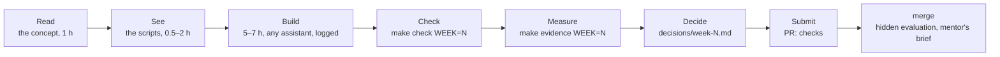

# The AI Engineering track

<!-- Rendered on the hub page in three parts: "The track", "How a week works", "Sessions and gates".
     Keep the three level-2 headings below exactly as they are; the page splits on them. -->

## The track

You are preparing for Track 3 of the Entry-Level AI Skills framework, *AI Engineering*: you build a
product whose main feature is a model somebody else trained. Switch the model off and the product
stops working. Six weeks, eleven areas, one repository that grows week by week into something you
can deploy, measure and defend in an interview.

| # | Cluster | Area | Week |
| --- | --- | --- | --- |
| 1 | Foundations | Software foundations for AI work | 0 (assessed, not taught) |
| 2 | Foundations | Working with a model as a component | 1 |
| 3 | Foundations | Context engineering | 2 |
| 4 | Retrieval and agents | Retrieval, done properly | 2 |
| 5 | Retrieval and agents | Grounding and honest answers | 3 |
| 6 | Retrieval and agents | Agents and tools | 4 |
| 7 | Retrieval and agents | Connecting to real systems (MCP) | 4 |
| 8 | Trust and shipping | Evaluation | 3 |
| 9 | Trust and shipping | Observability and cost | 5 |
| 10 | Trust and shipping | Security and guardrails | 5 |
| 11 | Trust and shipping | Shipping and proving it | 6 |

The two areas that decide most hiring outcomes are Retrieval (Week 2) and Evaluation (Week 3).
They get the most hours.

## How a week works

Every week has the same shape: **Read, See, Build, Measure, Decide, Submit**. You never scaffold
a new project after Week 0. Each week names one lesson; every build item is core (needed for it,
checked by the gate) or stretch (shown to your mentor, never blocking).

- **Read**: one page, one sentence you must be able to say back in your own words, a few
  diagrams and a short reading list. Write the sentence in `reflections/week-N.md`, Q1.
- **Run**: one or two small scripts and a few files to read. Change nothing yet.
- **Build**: what the week asks for, specified as behaviour that must hold, not as a list of
  functions. Use any assistant you like, and log it in `ai-use/week-N.yml` as you go.
- **Check**: `make check WEEK=N`, as often as you like. Green is the goal, not the end.
- **Measure**: `make evidence WEEK=N` runs the week's measurements on a real model and keeps them
  in `evidence/week-N.json`, with the commit, provider and model.
- **Decide**: `decisions/week-N.md`, the one decision of the week, with the numbers from the
  evidence file. The gate checks that they match.
- **Submit**: a pull request from `week-N` to `main`, 24 hours before a session. The checks run.
  Merging it is what marks the week done: within a day the programme collects the data for your
  mentor's brief from what you merged and, from week 2, runs its hidden evaluation on questions you
  never see.

Your **route** (start, core or pro) is set by your mentor at discovery from two questions, in
order: can you do the basic work of the track at all; and do you check what you produce. It holds
for the programme, with one correction point at session 2. The route changes what you are given,
never what is measured:

| | start | core | pro |
| --- | --- | --- | --- |
| Exercises | faults named, a worked example given (`weeks/N/routes/worked_example.py`) | faults present, not located, count not given: each exercise file is complete with mistakes planted | no helpers, one real constraint added (`weeks/N/routes/pro.md`) |
| Pace | slow, mentor-supported | compressed | self-directed |
| Finished piece | modest and completed | full | harder, made public |

You make your repository from your route's template, so it holds that route and no other; each
week's `routes/` page says what it means for the week. If the route is corrected at session 2, the
programme opens a pull request on your repository that swaps the files for the weeks still ahead.

## Sessions and gates

Mentor time is four sessions, and nothing else except up to two fifteen-minute unblock calls.
That is the framework's rule, and it is what makes the route matter: the sessions are where the
hours go, so what they are spent on depends on where you started.

| Session | When | Length | What happens |
| --- | --- | --- | --- |
| **1. Discovery** | Week 0 | 45 min | An observed task sets your route and takes the starting measure. The finished piece is agreed |
| **2. Direction** | end of Week 1 | 45 min | Route confirmed or a correction recommended. Unseen items with your assistant; your decisions without it |
| **3. Observation** | end of Week 3 | 60 min | You explain the gap between your score and the hidden score, diagnose a hidden failure with your assistant, then defend your threshold and judge without it |
| **4. Defence** | end of Week 6 | 60 min | Demo; three decisions defended with tools closed; an unseen change with your assistant; the starting measure again |

From session 2, every session has a half where you drive your own AI assistant on something
unseen while your mentor watches how you steer it, and a half with tools closed. Interviews now
have both kinds of round.

Weeks 2, 4 and 5 have no session: the gate, the self-tests and this page are your feedback, and
your mentor passes on the hidden evaluation's totals. Your mentor reads a one-page brief built from
each week you merge (they do not read your diff) and gives a one-click verdict: on track, something to probe
at the next session, or an offer of an unblock call.

**Unblock calls**: up to two, fifteen minutes each, on request, after you have attempted the thing
yourself. Send what you tried with the request.

**Where the hours go**, by route:

| Route | Sessions 2 and 3 concentrate on | Pace |
| --- | --- | --- |
| start | the basics: Weeks 1–2, getting the model layer and retrieval working at all | slow, mentor-supported; use both unblock calls early |
| core | quality: Weeks 3–5, checking what you produce: evaluation, guardrails, traces | compressed |
| pro | evidence: Week 6, the deployed piece, the write-up, the defence | self-directed |

Three layers of evidence, from cheapest to most human. None of them is self-reported.

| Layer | Who | What it measures |
| --- | --- | --- |
| **The gate**: `make check WEEK=N` | CI, on every pull request, with a fake model so no key is needed | Lint, strict types, that week's tests under two fake providers, the records, and from Week 3 the evaluation gate, from Week 5 the attack gate |
| **The hidden evaluation** | The programme, on each week you merge from week 2, on one reference model | About 150 questions and 20 agent tasks written for your product, never shown to you: your mentor brings you the totals |
| **Your records** | You write; the gate checks them; your mentor's brief shows them | The decision and the numbers behind it, what an assistant did and what you checked, your reflection |
| **Your mentor's judgement** | Sessions, against one rubric | How you steer an assistant on something unseen, and whether you can explain your own work without one |

Work reaches your mentor a day early, so the session is not spent finding out what is there. You
talk more than your mentor, because otherwise the hour drifts into them solving the problem.

Understanding sets a ceiling: at the Defence your mentor judges whether you can explain your own
work, and that judgement caps what the programme records; it never adds to it. You are always
shown what you produced and what it missed. You are never shown the measure that goes to the
programme, and neither is this page. The self-tests here are yours alone.
