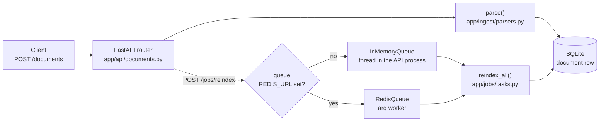

# Week 0 — Foundations gate

Area 1 of the track is not taught here. It is checked. This week you show that the ground the
next six weeks stand on is solid, and your mentor uses what they see to place you on a route.

**Read [`docs/start-here.md`](../../docs/start-here.md) first: Track 3 in ten minutes.** Then
`BRIEF.md` in this folder. It is the client's own brief, and it is the reason every
later week is shaped the way it is. Then read `REQUIREMENTS.md`: twelve things the finished system
must do, each one checked. `../../RULES.md` says what is expected of you, including the one rule
about using AI tools.

**There is no model anywhere in the service yet.** That is deliberate. The desk's customers and
tickets (`support/`) are already loaded into the database, and nothing reads them yet: week 1's
tools are the first thing that will.

## What the service does today

| Endpoint | Purpose |
| --- | --- |
| `POST /documents` | Upload a `.pdf`, `.csv`, `.md` or `.txt`; it is parsed to text and stored in SQLite |
| `GET /documents/{id}` | The text and metadata back |
| `GET /documents` | List |
| `POST /jobs/reindex` | Start a slow batch job on a queue and return at once |
| `GET /jobs/{id}` | Its status |
| `GET /health` | Liveness |

At start the service also loads `support/customers.json` and `support/tickets.jsonl` into two
tables, `customer` and `ticket` (`app/support.py`).

One upload, drawn. Trace it in the code, then trace it aloud.




## Do this (about 5 hours, all of week 0)

Your discovery session has already set your route: you made this repository from your route's
template, and `.route` says which. Now, in this order:

1. **Two free model keys, from two different providers**, stored as Codespaces secrets
   (`GEMINI_API_KEY`, `GROQ_API_KEY`, ...), never in a file. Set the second as
   `MODEL_FALLBACK_PROVIDER` in `.env`. Two, because week 1 swaps between them and free quotas run
   out. `make live-check` proves each one works.
2. **Connect your repository to the programme**: the "Connect repo" link you were sent installs
   the programme's GitHub App on this one repository. From then on your pull requests get the
   hidden evaluation and your mentor gets a brief; the programme records a baseline on your
   untouched starter. If the programme sends a "Your product" pull request (your own variant of
   the product), merge it.
3. `make check WEEK=0`: read the output. Everything should be green.
4. `make run` — open the forwarded port, go to `/docs`, upload `samples/invoice.md`, read it back.
5. Start a reindex job, then immediately call `/health`. Notice the API did not wait.
6. Read, in this order, and be ready to explain each one in two sentences:
   - `app/main.py` → `app/api/documents.py` → `app/ingest/parsers.py` → `app/db/session.py`
   - `app/jobs/queue.py` — why are there two queues, and which one is running right now?
7. Build the production image and run it:
   ```
   docker build -t ai-eng-track .
   docker run -p 7860:7860 ai-eng-track
   ```
   Then `curl localhost:7860/health`.
8. Fill `reflections/week-0.md` (copy `REFLECTION_TEMPLATE.md` there), Q1 only: trace one upload request from
   the HTTP call to the row in SQLite, in your own words, under 150 words.

## Session 1: Discovery (45 minutes, before this repository existed)

You were given a small support agent that answers badly, with any AI assistant you normally use,
and asked to find out why. It had two faults planted: a loud one that visibly breaks, and a silent
one that returns a confident, fluent, wrong answer your assistant probably said was fine. Which you
found set your route. Your mentor shows you what you found and what you walked past at session 2;
it is the reason weeks 2 and 3 matter as much as they do.

Your mentor confirms from the first brief that this week is done: the repository exists, checks
are green, the baseline is recorded, and your live-check shows both keys working. If they are not
by the end of the week, that is what an unblock call is for.

Your route is already in this repository: you made it from your route's template, and `.route`
says which. Open `weeks/1/CONCEPT.md`.

## Optional: self-test

`QUIZ.md` in this folder has a few questions on this week's concept, each with an explanation. On the hub page they are interactive and scored, but the score lives only in your browser: it never reaches the repo, your mentor or your route. Use it to find what to re-read.
