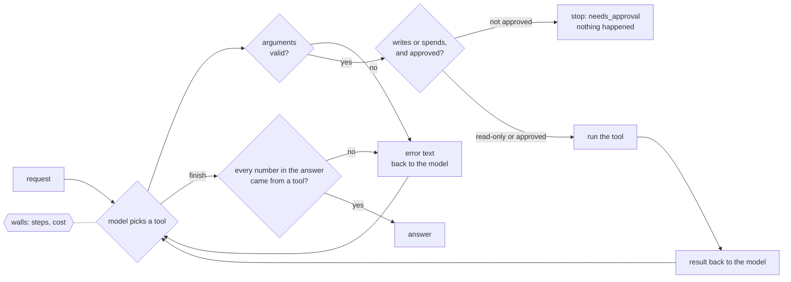
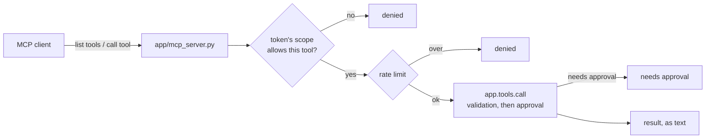

# Week 4 — Concept

> **Agency is a cost you place deliberately: where the model chooses, it must be measured,
> limited and approved. And so is model size.**

Read this once (about 25 minutes). Write the sentence in your own words in
`reflections/week-4.md`, Q1, before you touch code.

## Three ways to handle a request

| Way | Who decides the steps | Cost | Predictability | Handles a new request? |
| --- | --- | --- | --- | --- |
| Plain code | the programmer, in advance | zero | total | no: someone writes more code |
| Workflow | the programmer; the model does one job inside a step | a few calls, fixed | high | only if the steps still fit |
| Agent | the model, as it goes | varies per run | low | yes, sometimes, at a price |

An agent is slower, more expensive and less predictable than a workflow, **and on some requests it
is the only thing that works**, because the next step depends on what the last tool returned. The
skill is not preferring one; it is saying, task type by task type and from something you
measured, which deserves which. That is your routing table.

An agent is a loop: the model picks a tool, you run it, you show it the result, it picks again.
The loop needs walls or it will hurt you:

- **Schemas and validation** on every tool, so a malformed call becomes an error the model reads.
- **A step wall and a cost ceiling.** Without them a confused agent runs until the budget is gone.
- **Approval in code** on anything that writes or spends. Not a sentence in the prompt: a door the
  tool cannot get through until a person says yes, for that run.
- **The number check.** A number in the answer must be a number a tool returned.
- **One exit.** `finish` ends the run; everything else is a step.

The named patterns are variations on where the deciding happens: *reason and act* (the loop
above), *plan then execute* (decide the steps first, then run them; pro builds it), *human in the
loop* (the approval stop), *evaluator and optimiser*, *orchestrator and workers*. Each costs more
and predicts less than the loop it replaces.

## Letting a model analyse data

A model that can write SQL can drop a table, read another desk's tickets, or invent a column.
The safe way to let it analyse is a short **allowlist** of questions, each with parameters, run by
you over exactly the rows it may see. Read-only, parameterised, and the result says what was
asked. Then enforce, rather than hope, that the number in the answer is the number the query
returned: "9" becomes "about a dozen" more often than you would think.

## When a frontier model is worth its price

Small models fail first on multi-step planning and on choosing among many tools. A frontier model
can be ten to fifty times the cost per call. So the answer is usually a mix, decided task type by
task type: the cheap model where it is right, the frontier model only where the measurement says
the cheap one fails. You run your trajectory set once on a frontier model through the programme's
key, and your routing table gets a second column: which model each task type deserves.

## Connecting to real systems

The Model Context Protocol is how a client (an IDE, a desktop app, another agent) discovers and
calls your tools without a client written for each. It is a transport and a schema convention. It
is **not** a permission system. Behind an MCP server, three questions matter more than the
protocol:

- **Who is calling, and what may they call?** A token gets the smallest set of tools its job needs
  (least agency). A reader cannot act; an agent cannot spend.
- **Has a person approved this action?** Scope says who may ask; approval says yes. Both are
  checked in code, on every call.
- **What happens when a tool fails halfway?** The server answers with an error and stays up.

## What this looks like in the service

| Idea | Where it lives | What you do this week |
| --- | --- | --- |
| Action tools | `app/tools/actions.py` | Design `draft_reply`, `escalate`, `issue_credit`; say truthfully which write and spend |
| Analysis | `app/tools/analysis.py` | Design `query_tickets`: an allowlist, read-only |
| The door | `app/tools/base.py` | Read it: validation, then approval |
| The loop | `app/agents/agent.py` | Build it: walls, recovery, the approval stop, the number check |
| Three ways | `app/agents/plain.py`, `workflow.py`, `scripts/compare_week4.py` | Measure all three on three task types |
| Model size | `scripts/model_compare.py` | Your model against a frontier one |
| MCP | `app/mcp_server.py`, `app/mcp_scopes.py` | Serve the tools; try to break your own scopes |

## What you should be able to say by Friday

- Your routing table: for each task type, plain code, workflow or agent, cheap or frontier model,
  and the two numbers that decided each row.
- Why approval lives in code and not in the prompt, with what `explore/w4_02` showed you.
- What your agent did with ticket T-2099, step by step, and what stopped it.
- What a `reader` and a `supervisor` token can and cannot do through your MCP server, and how you
  proved it.

## Read more

Checked September 2026.

- [Anthropic: Building effective agents](https://www.anthropic.com/research/building-effective-agents) — "workflows before agents", with the named patterns above. Read it first.
- [ReAct: Synergizing Reasoning and Acting in Language Models](https://arxiv.org/abs/2210.03629) (Yao et al., 2022) — the loop in `agent.py` is this paper's idea.
- [Model Context Protocol](https://modelcontextprotocol.io/) — the specification, and the [Python SDK](https://github.com/modelcontextprotocol/python-sdk) the server is built on.
- [LangGraph](https://langchain-ai.github.io/langgraph/) — the framework for the rebuild; read "Human-in-the-loop" for how it handles approval.
- [OWASP Top 10 for LLM Applications](https://owasp.org/www-project-top-10-for-large-language-model-applications/) — read "Excessive Agency" this week; the rest is week 5.
